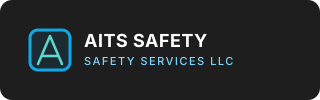

<article class="max-w-4xl mx-auto py-8 md:py-16 reveal-on-scroll">
  

    <a href="/case-studies/" class="text-accent text-xs font-semibold hover:underline inline-flex items-center gap-1.5 mb-4 touch-target">
      &larr; Back to Case Studies
    </a>
    

      Commercial Safety Services
      Dubai & Northern Emirates
    

    <h1 class="font-heading text-3xl md:text-5xl font-bold text-white mb-4">
      AITS Safety LLC: Commercial Lead Generation & Local Search Strategy
    </h1>
    

      Capturing high-intent B2B corporate inquiries for safety equipment inspection, compliance certifications, and industrial safety services in the UAE.
    

  

  

    <!-- Challenge Section -->
    <section>
      <h2 class="font-heading text-2xl font-bold text-white mb-4 flex items-center gap-2">
        01. Challenge
      </h2>
      

        

          AITS Safety LLC operates in a specialized B2B compliance environment where contract values are high, but decision-makers search with very specific technical terms. Primary hurdles included:
        

        <ul class="space-y-2 text-sm text-gray-300">
          <li class="flex items-start gap-2">
            &bull;
            <strong>High CPC Competition:</strong> Commercial safety compliance terms in Dubai carry steep auction bids with aggressive competitors.
          </li>
          <li class="flex items-start gap-2">
            &bull;
            <strong>Localized Search Gaps:</strong> Inadequate geographic targeting meant ads and search rankings failed to capture facility managers searching within specific industrial zones.
          </li>
          <li class="flex items-start gap-2">
            &bull;
            <strong>Unqualified Inbound Form Fills:</strong> Non-commercial consumers frequently submitted requests for personal safety gear rather than enterprise compliance contracts.
          </li>
        </ul>
      

    </section>

    <!-- Approach Section -->
    <section>
      <h2 class="font-heading text-2xl font-bold text-white mb-4 flex items-center gap-2">
        02. Approach
      </h2>
      

        

          <h3 class="font-bold text-white text-base mb-2">Industrial Hub Geo-Fencing & Radius Bidding</h3>
          

            Configured precision location targeting in Google Ads around key industrial areas (JAFZA, Al Quoz, Sharjah Industrial, Khalifa Industrial Zone) with bid adjustments prioritizing business hours.
          

        

        

          <h3 class="font-bold text-white text-base mb-2">Commercial-Intent Landing Pages</h3>
          

            Structured dedicated service landing pages featuring ISO accreditation credentials, compliance scopes, and B2B quotation request forms with required company validation fields.
          

        

        

          <h3 class="font-bold text-white text-base mb-2">Local SEO & Schema Markup</h3>
          

            Deployed local business structured data (`LocalBusiness` and `SafetyConsultant` schema) and optimized Google Business Profiles with accurate regional category tags and service menus.
          

        

      

    </section>

    <!-- Results Section -->
    <section>
      <h2 class="font-heading text-2xl font-bold text-white mb-4 flex items-center gap-2">
        03. Results
      </h2>
      

        <ul class="space-y-2 text-sm text-gray-300">
          <li class="flex items-start gap-2">
            &bull;
            Successfully filtered out residential inquiries, focusing ad spend strictly on corporate B2B requests for quotation (RFQs).
          </li>
          <li class="flex items-start gap-2">
            &bull;
            Achieved consistent top-of-page search impression share on commercial compliance and inspection keywords across target UAE industrial corridors.
          </li>
          <li class="flex items-start gap-2">
            &bull;
            Improved landing page conversion rate through streamlined corporate inquiry forms integrated with CRM notifications.
          </li>
        </ul>
      

    </section>

    <!-- Visual Assets Section -->
    <section>
      <h2 class="font-heading text-2xl font-bold text-white mb-4 flex items-center gap-2">
        04. Visual Assets & Architecture
      </h2>
      

        

          
          
Targeting: B2B Industrial Safety Geo-Clusters & Local Search Schema

        

      

    </section>
  

  

    <a href="/case-studies/" class="text-xs text-gray-400 hover:text-white transition touch-target">
      &larr; View all case studies
    </a>
    <a href="/contact/" class="touch-target px-5 py-2.5 text-xs font-semibold text-white bg-accent hover:bg-accent-light rounded-lg transition">
      Inquire for Similar Project &rarr;
    </a>
  

</article>
